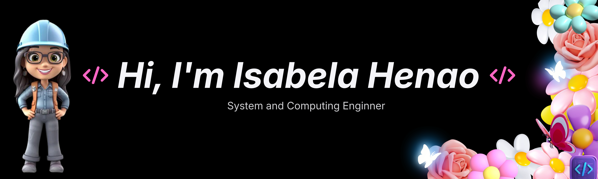

 

## About

Systems and Computing Engineering from Pereira, Colombia, focused on Full Stack development and the integration of artificial intelligence. I build end-to-end solutions, from robust backend architectures to intuitive interfaces, combining analytical thinking and creativity to solve real-world problems.

Outside of coding, I enjoy going to the gym, exploring new technologies, and contributing to open-source projects.

---

## Let's connect

<!-- Reemplaza la URL por la de tu portafolio cuando lo publiques -->
**Portfolio:** [github.com/IsabelaHenaoGarcia](https://github.com/IsabelaHenaoGarcia)

---

## Tech Stack

### Languages

### Frontend

### Backend

### Databases

### AI and Agents

### Tools

---

## GitHub Stats

<!-- Si despliegas tu propia instancia en Vercel, reemplaza github-readme-stats.vercel.app por tu dominio -->

 

